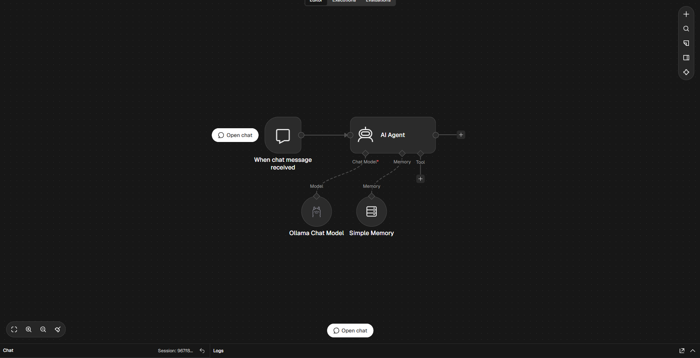
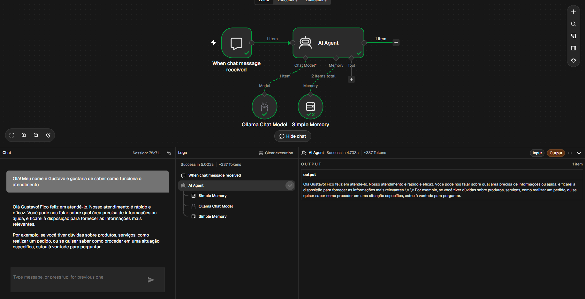
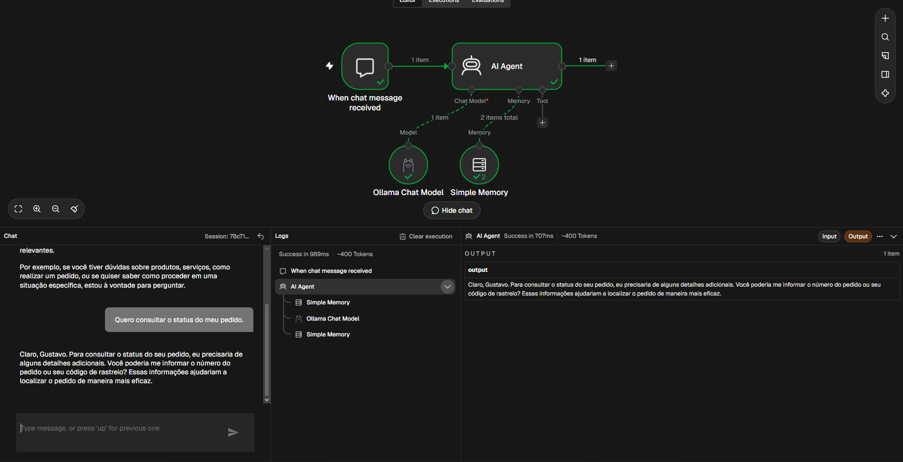
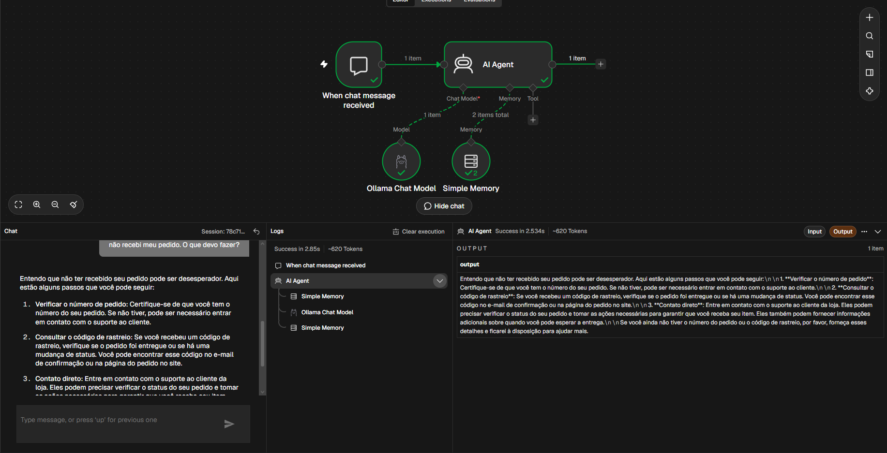

# 🤖 AI Support Agent

Agente inteligente de atendimento ao cliente desenvolvido com n8n e inteligência artificial.



### 💬 Demonstração

**1. Primeiro contato**



**2. Consulta de pedido**



**3. Problema com entrega**



### 🛠️ Tecnologias
- n8n
- Ollama
- Qwen 2.5 3B
- Simple Memory

### ✨ Funcionalidades
- Atendimento automatizado por chat.
- Respostas em português brasileiro.
- Memória de conversação.
- Respostas claras e profissionais.

### ⚙️ Como funciona
O agente recebe mensagens, interpreta as solicitações e gera respostas utilizando um modelo de IA local, mantendo o contexto da conversa.

### 📁 Estrutura

```text
AI-Customer-Support-Agent/
├── automacoes/
│   └── AI Support Agent.json
└── README.md
```

### 🚀 Objetivo
Projeto desenvolvido para praticar a criação de agentes inteligentes, automações e integração com modelos de inteligência artificial.

**Status:** Primeira versão funcional.
